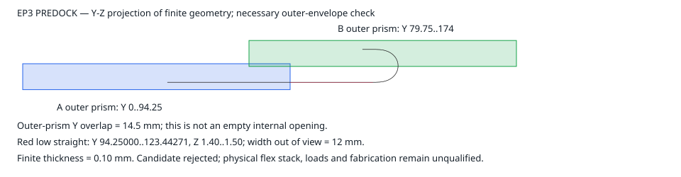

# Phase 3：真实 donor 导入与完整内部路径研究

日期：2026-10-20 UTC。结果属于开放的 PR #36；main 为 a1b3cc1，PR #35 继续是独立 draft，PR #25 已关闭且未合并旧驱动。

**本轮已完成真实部分 donor 导入、EP3 三态原生研究和独立 STEP 回读；EP3 三态均拒绝，实物平台与完整手机尚未验收。**

## 执行身份与真实结果

| 执行 | 提交 | 结果与范围 |
|---|---|---|
| donor 采集器产品测试首次运行 | 3e6864ccea6c03a651dd220a0c1510c2ea22dfec | 102 项，13 个旧模拟接口错误 |
| donor 测试适配与正式实机采集 | f4db100cb62c0ac492118bf605b0e9e7ac7cce32 | 同一 102 项通过；正式只读 17 条命令全部成功 |
| 产品与 EP3 选择测试 | bdb1bc19fce49692fd49cd508031bfc456e15208 | 2 组、109 项通过；源码前后未变 |
| EP3 首次 native | bdb1bc19fce49692fd49cd508031bfc456e15208 | exit 1；保留 STOW 检查点，PREDOCK 见证构造发生类型错误 |
| EP3 执行接口限定修复 | a33e58cd555b8d9aff1e3649f79cd0dba378a804 | 7 项 EP3 测试、8 个 native 小案例及 1 个类型见证通过 |
| EP3 三态新执行 | a33e58cd555b8d9aff1e3649f79cd0dba378a804 | exit 0，656.874 秒；三态均完成、候选均拒绝 |
| 独立 STEP 回读 | native 来源 a33e58cd555b8d9aff1e3649f79cd0dba378a804 | 5 份 STEP 的声明检查通过，覆盖范围见下文 |

配置为 **1310 项 / 34 组**。109 项属于 bdb1bc1；a33e58c 的限定回归和三态执行有自己的报告。没有把这些执行合称一次完整 1310 项通过。此前 phase2 的 1297 项失败、14 项修复和跨两次执行的选择覆盖继续保留原身份。

## 真机身份已经落入当前接口配置

正式采集使用已有 Pocket4 服务 127.0.0.1:5061，17 条命令成功，起止 transport ID 均为 37，服务 boot/PID/start ticks 未变，设计输入与 f4db100 提交一致。导入记录只确认型号 **XT2551-3**；其余 10 个身份字段、7 类实物部件标签、12 条物理端子接口仍未绑定。ro.boot.hwrev 为空，没有据此填写主板版本。

原件、导入动作与适用范围见 [DONOR_IMPORT.md](hardware/DONOR_IMPORT.md) 和 [不可变身份记录](../hardware/records/xt2551-3-20261020-f4db100-identity/record.json)。软件电池读数与官方容量规格保留不同来源，尚未证明 4700 mAh 在新布局中成立。

## 完整端接与三态原生结果

EP3 保留每端 20 个有限实体、双端四块 PCB，材料总长 124 mm（100 mm 自由段和两个 12 mm 补强段）。外侧补强夹爪改为 0.35 mm；名义 M2 轴长明确由 2.45 mm 改为 1.4 mm。这些是研究尺寸，材料、工艺、螺纹和保持力仍未取得实测资格。

共完成 **15906 个实体配对检查**，配对计算错误 **0**，包络差集计算错误 **0**。配对数包含边界盒确定分离的检查，不表示全部调用了 Boolean Common。

| 状态 | 完整参与体 | 外部配对 | 外部正交叠 | 两端/带体内部正交叠 | 有材料在两舱域外的候选体 | 结论 |
|---|---:|---:|---:|---:|---:|---|
| STOW | 154 | 4633 | 6 | 0 | 0 | 拒绝 |
| PREDOCK | 154 | 4633 | 5 | 4 | 1 | 拒绝 |
| OPEN | 161 | 4920 | 5 | 4 | 0 | 拒绝 |

两端各 190 个自身配对的结果，以及逐态具体对象和 Common 体积见 [native-summary.json](native-summary.json)；[完整报告](native/native-report.json.gz) 保留所有配对。STOW 的六处真实交叠与首次失败运行逐名、逐值比对一致，其中 A 承载夹爪与电池分配为 **18 mm³**。

PREDOCK 低直段见证的 Y 范围为 **94.25000–123.44271 mm**，Z 为 **1.40–1.50 mm**，带宽 12 mm。原生见证体积、它与实际有限带体的 Common、减去两个独立舱体后的残余均为约 **35.031250526 mm³**。

该见证是可单独复核的低直段子集；整个有限带体在两舱域外的残余为 **49.088288346 mm³**。PREDOCK 的四处 B 端内部交叠涉及承载夹爪、DP/DS 两块小 PCB 与静态 26 线转接预留；OPEN 的四处涉及两根 M1 板轴、承载夹爪与 DP 小 PCB。具体体积保留在机器摘要中。

固定单 U 族还存在 B 锚点必要区间矛盾：内部低直段要求不高于 11.5 mm，而完整 B 端尾向占用要求不低于 21 mm，相差 9.5 mm；另加壁厚/净距请求后为 10.35 mm。该结论限定在当前端接方向、层位和路径族，下一种路径需联合处理换层开口、储长区域及 B 端出带方向。推导见 [独立约束审阅](ep3-constraint-review.md)。

## 保留的失败与限定修复

第一次 native 执行用时 427.276 秒，最终报告未完成。STOW 有 6 处真实正 Common，以及 20 条 A 端“已减为空材料后继续 cut B 域”的异常；PREDOCK 则在 numpy.float64 进入严格 box 入口时停止。见 [首轮失败](native-first-failure/native-execution-failure.json)、[首轮执行回执](validation/ep3-native-execution.json) 和 [完整检查点](native-first-failure/native/progress.json.gz)。

修复保留全局有限数与拓扑检查，只在见证构造边界转换内置 float，并在每次差集后验证完整材料，遇到有效空集合后停止。微小正残余没有被归零；游离 Face 仍失败。候选配置和端接构造未变，差异与实际回归见 [修复提交回执](validation/ep3-native-api-repair-commit.json)、[限定回归](validation/ep3-api-repair/native-api-regression.json)、[六处交叠保留对照](validation/retained-STOW-counterexamples.json)。

## STEP 回读的准确范围

两个端接文件分别读取 20 体，三个整装分别读取 154、154、161 体；全部实体有效且体积为正。每态报告中的 41 个候选体完成一对一 bounds/volume 匹配；端接文件另按报告材轴置于三态核对。

生成报告没有提供其余 113/113/120 个外障碍的逐体数值，因此它们只有实读数量、有效性和正体积记录，未宣称整装所有材料或标签身份逐一等价。数值回环容差不是制造公差。原 native 文件中的“尚未独立回读”字段保留原执行时状态，后续实际结果由 [独立回读报告](validation/ep3-independent-readback/report.json.gz) 和 [reader](read_ep3_step_independent.py) 补充。

## 当前托管与物理验收

已归档的 f4db100 [Actions 原始报告](actions/f4db100-run39359899335.json) 有 12 个新 job、零执行 step、12 条付款/额度提示；42679be 的[上一发布报告](actions/42679be-run39355931047.json)也保留自己的直接证据。最终发布 head 的后续检查会记录在 PR36 正文，避免把旧 head 的结果移作新 head 结果。

物理平台、真实主板/屏幕/COF/电芯几何、完整正反程、无电实物、柔性实样及改装电气链均有未完成项。下一批具体输入和验收见 [NEXT_PHYSICAL_INPUTS.md](NEXT_PHYSICAL_INPUTS.md)；整体空间与薄件工艺见 [装配审阅](assembly-followup-review.md)。PR35 未启动新的 FE/QP。

`candidate_go`、`fixture_fabrication_go`、`manufacturing_go`、`physical_phone_verified` 继续为 false。机器摘要见 [SUMMARY.json](SUMMARY.json)，文件字节身份见 [artifact-index.json](artifact-index.json)。
